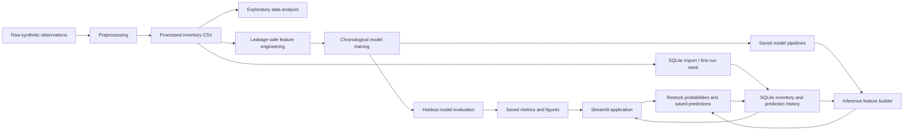

# Smart Inventory & Restock Prediction System

A decision-support portfolio project combining synthetic inventory records, public retail transaction analysis, chronological model experiments, SQLite, and a Streamlit application.

> **Data and model scope:** All inventory observations are synthetic. Holdout results below measure performance on a synthetic chronological split and do not establish accuracy on real store operations. Predictions are decision support, not guarantees.

> **Real-data scope:** The optional UCI Online Retail II workflow uses historical transactions to examine sales activity. It does not contain stock-on-hand, store locations, supplier lead times, or replenishment events, so it cannot validate the synthetic restock classifier or calculate operational reorder quantities.

## Problem and objective

Inventory teams need visibility into stock levels and restock activity across products and stores. This project explores a specific supervised-learning question: **will the same product/store pair have a restock event on its next qualifying daily observation?** The application presents stock history, descriptive analytics, probabilities from saved models, and recorded prediction history.

## Features

- Monitor product, store, inventory-record, low-stock, and out-of-stock counts from SQLite.
- Explore real historical transaction volume, product sales, and customer-country patterns from UCI Online Retail II in a separate sales workspace.
- Search and filter inventory by product name or ID, category, store, and date.
- Add validated observations while preventing duplicate product/store/timestamp records.
- Explore stock levels, daily and monthly patterns, categories, stores, and restock events with interactive charts.
- Compare saved Logistic Regression and Random Forest pipelines using the validation-selected thresholds.
- Generate probabilities using the exact Phase 6 input columns and only data available through the selected source observation.
- Save predictions with their source record, model version, probability, threshold, and predicted class.
- Review the original Phase 7 holdout report and saved figures without recalculating them in the application.

## Technology

Python 3.15.2 · Pandas · NumPy · Scikit-learn · SQLite · Streamlit · Altair · Joblib · OpenPyXL · Matplotlib · Seaborn

The application charts use Altair's interactive Vega-Lite rendering. Matplotlib and Seaborn support the analysis and evaluation reports. A Jupyter installation is optional for opening the EDA notebook and is not part of the Streamlit runtime dependency set.

## Architecture



The Python modules keep responsibilities separated:

- `src/data_generation.py`, `src/preprocessing.py`, and `src/feature_engineering.py` create and prepare data. Historical calculations are based on past events; the next-observation label is never a predictor.
- `src/model_data.py`, `src/model_preprocessing.py`, `src/model_training.py`, and `src/model_persistence.py` define the chronological split, training-only preprocessing, fitted pipelines, and saved artifacts.
- `src/evaluate_model.py` reconstructs the saved chronological holdout evaluation and writes Phase 7 reports.
- `src/database/` owns SQLite schema, connections, repositories, and idempotent CSV import.
- `app/services/` handles database reads, validated inventory writes, first-run database setup, and as-of inference. `app/pages/` and `app/components/` provide Streamlit UI and charts.

## Phase 7 holdout results

The saved report evaluates **2,160 chronologically held-out synthetic observations**. The operating thresholds were selected on a separate chronological validation slice of training data; the holdout was not used to choose them.

| Model | Threshold | Accuracy | Precision | Recall | F1 | ROC-AUC | Average Precision |
|---|---:|---:|---:|---:|---:|---:|---:|
| Logistic Regression | 0.75 | 89.5% | 55.9% | 76.4% | 64.6% | 0.945 | 0.629 |
| Random Forest | 0.53 | 86.4% | 47.9% | 93.7% | 63.4% | 0.942 | 0.601 |

These results describe the provided synthetic data only. They do not show how either model would perform on real inventory, and feature importance or model associations do not establish causes. In practical terms on this holdout, Random Forest identified more actual restock events and raised more false alerts; Logistic Regression had higher precision and accuracy at its selected threshold.

## Project structure

```text
.
├── .streamlit/config.toml
├── app/
│   ├── dashboard.py
│   ├── config.py
│   ├── components/          # shared layout and charts
│   ├── pages/               # seven application pages
│   └── services/             # queries, writes, startup, and inference
├── data/
│   ├── synthetic_inventory.csv
│   ├── processed_inventory.csv
│   └── engineered_inventory.csv
├── models/                   # saved Phase 6 pipelines and metadata
├── notebooks/inventory_eda.ipynb
├── reports/                  # Phase 7 metrics, tables, and figures
├── src/
│   ├── database/              # schema, connection, repositories, seeding
│   ├── data_generation.py
│   ├── preprocessing.py
│   ├── feature_engineering.py
│   ├── model_*.py
│   ├── evaluate_model.py
│   └── uci_online_retail.py
├── tests/
├── requirements.txt
└── README.md
```

`data/inventory.db` is a local mutable database and is intentionally excluded from Git. The three CSV datasets, saved model pipelines, evaluation artifacts, source, notebook, and tests are included so a clone can reproduce the workflow and serve inference.

The UCI source workbook and derived sales summaries live under `data/external/`, which is ignored by Git because the data can be fetched again. The application fetches it only when a user opens Sales intelligence and selects the fetch action. The source workbook is about 43.5 MB; the prepared file aggregates positive transaction lines by date, product stock code, and customer country. It excludes cancellation invoices and invalid/non-positive sale lines, and writes a provenance record alongside the summary.

UCI attribution: Chen, D. (2012). *Online Retail II* [Dataset]. UCI Machine Learning Repository. https://doi.org/10.24432/C5CG6D. Licensed under CC BY 4.0. The historical timestamps have no timezone metadata and are used as source-local calendar dates.

## Windows installation and local run

Use Python **3.15.x** to match the environment that created the saved Scikit-learn pipelines. Confirm `python --version` reports 3.15.x before creating the environment.

From PowerShell in the project root:

```powershell
python -m venv .venv
.\.venv\Scripts\Activate.ps1
python -m pip install --upgrade pip
python -m pip install -r requirements.txt
python -m src.database init
python -m src.database seed
python -m streamlit run app/dashboard.py
```

The `init` and `seed` commands are safe to repeat. The app also initializes its schema and imports `data/processed_inventory.csv` automatically if it starts with an empty inventory database. It does not replace an existing database that already contains observations.

To view or execute the EDA notebook, optionally install Jupyter with `python -m pip install jupyter`, then run `python -m jupyter notebook notebooks/inventory_eda.ipynb` from the project root.

### Public sales data

The application has a separate **Sales intelligence** page. Select **Fetch UCI sales dataset** to download the official UCI workbook and prepare the local daily summary. To fetch or rebuild it from PowerShell:

```powershell
.\.venv\Scripts\python.exe -m src.uci_online_retail
.\.venv\Scripts\python.exe -m src.uci_online_retail --refresh
```

The first command downloads the source if it is not already present. `--refresh` rebuilds the derived CSV from the local workbook; it does not re-download unless the workbook is missing. The app excludes cancellation invoices, non-positive quantities/prices, invalid dates, and missing product or country keys. `sales_value_gbp` is quantity × unit price for kept sale lines; returns are excluded, so this is not net accounting revenue. Sales days with no line are absent rather than assumed to be zero demand.

The UCI download is cached locally in `data/external/`; it does not modify any synthetic, processed, or engineered inventory dataset or the inventory SQLite database. On Community Cloud the source must be fetched after app startup, and the generated local file is not durable across restarts.

Set `INVENTORY_DB_PATH` to choose a different local database file. Absolute paths and paths relative to the project root are supported. The database schema and imported records are managed by the existing `src.database` module.

## Prediction workflow

For a selected product and store, the app takes the latest chronological observation and builds the exact ten Phase 6 inputs: category, store location, stock quantity, availability status, previous availability status, historical restock count, masked restock age, age validity, weekday, and month. It excludes IDs, names, timestamps, the current restock event, future observations, and the training target. Unknown restock history remains masked and is imputed by the fitted pipeline. The positive-class probability is read from the model's `classes_`; the selected model threshold is applied, then the result is stored in `predictions`.

The saved target is a restock event on the next qualifying chronological daily observation. That observation is not necessarily tomorrow, and a probability is not a promise that a delivery will occur.

## Tests and quality checks

Run the full suite from the project root:

```powershell
.\.venv\Scripts\python.exe -m unittest discover -s tests -v
.\.venv\Scripts\python.exe -m compileall -q app src tests
git diff --check
```

Tests use temporary SQLite files. They do not need to modify the local inventory database or overwrite source datasets, fitted pipelines, or Phase 7 evaluation files.

## GitHub and Streamlit Community Cloud

**Live application:** [smart-inventory-restock-prediction-system.streamlit.app](https://smart-inventory-restock-prediction-system.streamlit.app/)

The public portfolio repository is [itscrackthecode/smart-inventory-restock-prediction-system](https://github.com/itscrackthecode/smart-inventory-restock-prediction-system); the Streamlit entry point is `app/dashboard.py`. The root `requirements.txt` pins the packages used to build the saved pipelines and run the project, and `.streamlit/config.toml` supplies the theme. No secrets are required.

Community Cloud's deployment settings offered Python 3.14, which was selected for the live app. The saved Scikit-learn 1.9.1 pipelines loaded successfully there, and both model prediction paths were exercised. The local training environment uses Python 3.15.2.

The Community Cloud app creates a separate SQLite database at the configured project-relative `data/inventory.db` path when no inventory database exists, initializes its schema, and seeds it from the committed processed CSV. The repository's mutable SQLite database is ignored and is not uploaded. This keeps hosted demo writes separate from the laptop database.

Community Cloud does **not guarantee persistence of local filesystem data**. Hosted observations and prediction history can disappear after a restart, rebuild, or redeployment. The hosted SQLite database is only for a disposable demonstration; it is not durable storage. Local SQLite writes persist on the laptop. A durable multi-user hosted app would require a persistent external database and its credentials, which are not part of this project phase.

The deployed app uses `main` and `app/dashboard.py`. Community Cloud will rebuild it when this repository's `main` branch changes.
